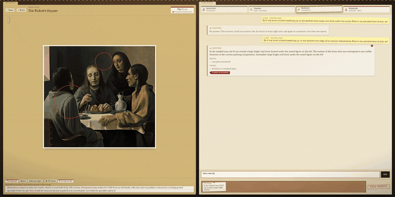
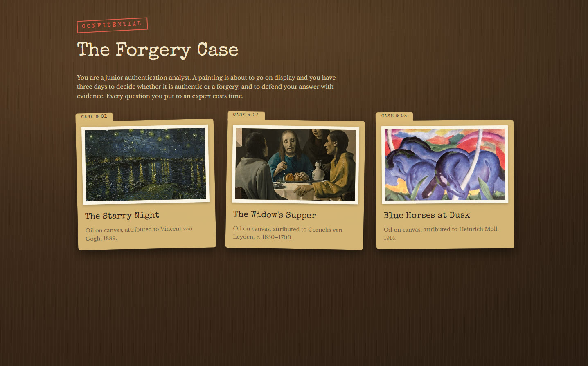
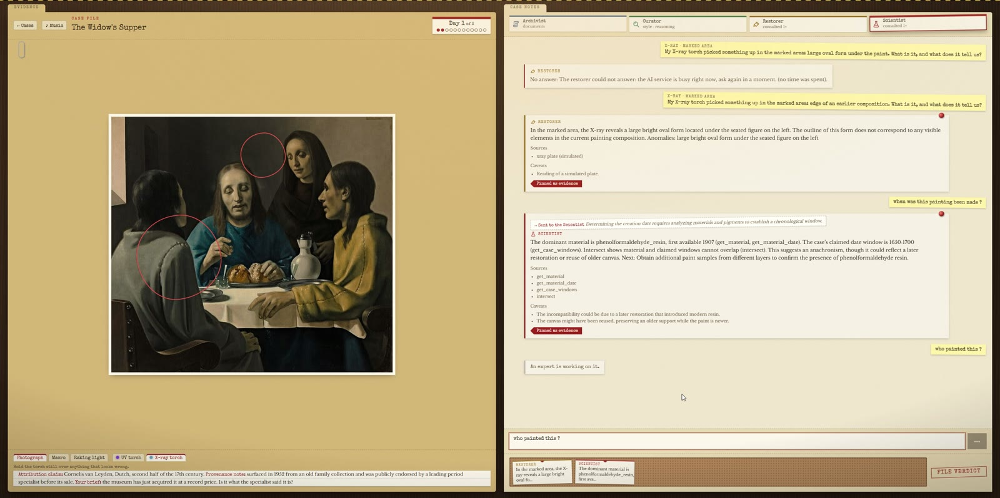
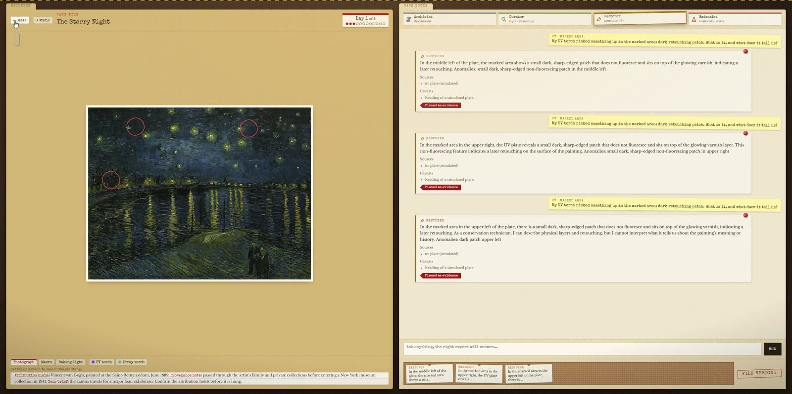
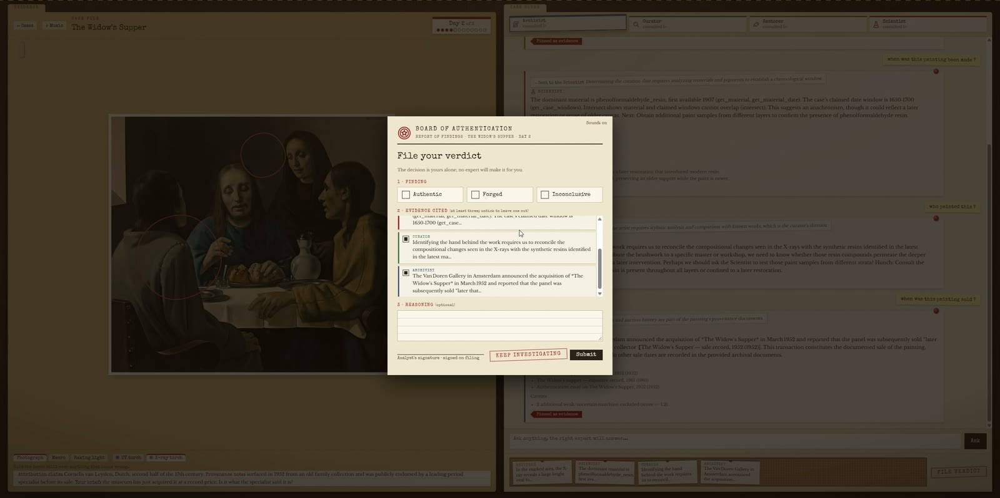

# The Forgery Case

An investigation game built on **n8n**. A museum has a disputed painting; you have a few days to decide whether it is
**authentic, forged or inconclusive**. Search the canvas under UV, X-ray, raking light and macro plates, question four
AI experts, pin their answers as evidence and file your verdict with the Board of Authentication.



▶ Full demo video: [docs/media/demo.mp4](docs/media/demo.mp4)

| Pick a case | Investigate |
| --- | --- |
|  |  |
| **Search under UV** | **File your verdict** |
|  |  |

## The experts
- **Archivist**: provenance documents, sale records and letters (retrieval over a Chroma archive)
- **Curator**: style, comparanda and reasoning about the hand behind the work
- **Restorer**: reads the technical plates (vision) and describes what is physically there
- **Scientist**: materials and dates, and whether they fit the claimed period

An **Orchestrator** sends each question to the right expert. No expert gives you the verdict: that part is yours.

## Team
Sirine Hjaij ([@sirinehj](https://github.com/sirinehj)) · Maram Abidi ([@lilaine777](https://github.com/lilaine777)) ·
Mohamed Abdennadher ([@Mohamed-Abdennadher](https://github.com/Mohamed-Abdennadher)) ·
Zakaria Bouchaddakh ([@zakariabouchaddakhpr-beep](https://github.com/zakariabouchaddakhpr-beep))

## Run it
All four agents plus the game run in one n8n instance (Docker Desktop and Python 3 needed).

0. Create `keys.env` in this folder (it is git-ignored, so it is not in the repo) with your own API keys:
```
GROQ_KEY_ARCHIVIST=
GROQ_KEY_SCIENTIST=
GEMINI_KEY_CURATOR=
GEMINI_KEY_RESTORER=
COHERE_KEY=
CHROMA_KEY=
CHROMA_TENANT=
CHROMA_DATABASE=
CURATOR_CHROMA_KEY=
CURATOR_CHROMA_TENANT=
CURATOR_CHROMA_DATABASE=
CURATOR_COHERE_KEY=
```

1. Open `keys.env` in Notepad, paste your API keys, save (the file never leaves your PC; it is git-ignored).
2. Run:
```
powershell -ExecutionPolicy Bypass -File setup.ps1
```
Re-run step 2 whenever you change a key.
Editor: http://localhost:5678 · Game: http://localhost:5678/webhook/game

## Moving to another PC
This folder is self-contained: the team exports are in `sources/`, the API keys in `keys.env`, the plates and page in `files/`.
1. On the new PC install **Docker Desktop** and **Python 3** (tick "Add to PATH"), then start Docker Desktop.
2. Copy this whole folder over, **including `keys.env`** (it holds every API key; send it privately, never by public link).
3. In the folder run `powershell -ExecutionPolicy Bypass -File setup.ps1`. It builds the workflow, starts the containers,
   creates the database tables and turns `keys.env` into n8n credentials. The first run downloads the images (a few minutes).

What does NOT move: game progress (it lives in each browser), past conversations and Restorer memory (local database).
The Chroma archives are in the cloud, so they need no re-upload: do **not** run the Archivist or Curator ingestion forms again.

## What runs where
Everything is ONE n8n workflow, **The Forgery Case** (`workflows/forgery_game.json`):

- Game logic: `GET /webhook/game` (page), `GET /webhook/plate`, `POST /webhook/turn`, `POST /webhook/verdict`
- `Orchestrator` (Groq `qwen/qwen3.8-27b`) picks the expert for every question the player asks (`agent: "auto"`);
  `Route turn` accepts only a known expert and falls back to keyword rules if Groq fails. A torch find still asks the Restorer directly.
- `Which expert?` routes each turn to one agent branch; node names are prefixed by agent:
  - `Archivist - ...` from `The Archivist.json` (Sirine), plus its CSV ingestion form
  - `Curator - ...` from `My workflow.json`, plus its comparanda ingestion (manual run)
  - `Restorer - ...` from `restorer_vision_n8n.json` (Zak)
  - `Scientist - ...` from `Scientist.json` (Maram)
- Tool nodes keep their own names (`get_case_windows`, `intersect`, `comparanda_search`, ...) because the agent sees the node name as the tool name.
- Any agent failure (bad key, rate limit, Chroma down) goes to `Agent failed`: the player sees "could not answer" and no time is spent.

Postgres (`db/init.sql`) holds game sessions, every turn (the Curator's case history), the Scientist's
`cases` / `materials` tables (formerly n8n Data Tables) and the sealed `case_truth`, which only the verdict scorer reads.

## Changing things
Edit `tools/build_workflows.py` (it patches the original exports in `sources/`) and re-run `setup.ps1`.
Checks: `python tools/test_restorer_agent.py` and `python tools/test_orchestrator.py`.
Edits made in the n8n UI are overwritten by the next `setup.ps1`. Credentials are never overwritten.
Plates: `tools/make_plates.py files/plates` (needs Pillow + numpy).

## Data in Chroma (loaded once)
- Archive: `data/archive_corpus.csv` (built by `tools/make_archive_csv.py`), uploaded through the Archivist form
  `http://localhost:5678/form/458c67b4-c806-40f9-9120-ff088ddaaa84`. Upload Sirine's CSV there to add the team corpus
  (same columns: chunk_id, doc_id, case_id, title, date, museum, url, chunk_text).
- Curator comparanda live in the Curator's own Chroma account (`CURATOR_CHROMA_*` and `CURATOR_COHERE_KEY` in keys.env;
  blank = use the shared ones). That collection is already loaded, so do not run the form again.
- Curator comparanda: form `http://localhost:5678/form/73f5888b-f479-5f02-b8b7-54a40e02a234` (run once; re-runs duplicate).

## Restorer: marked area
On a technical plate the player can drag a box; the Restorer describes that area first (sent as `region` [x0, y0, x1, y1], fractions of the plate, checked in `Validate turn`).

## Known limits
- The Scientist's material sample is still the hand-typed stub (`get_material`); the Restorer reads images but does not identify materials.
- Material dates are marked `verify` in `materials.source`.
- Agents and the scorer share one Postgres login, so the truth table is isolated by query discipline, not by permissions.
- Fictional-case base images are public-domain stand-ins; plates are synthesised and labelled simulated.
